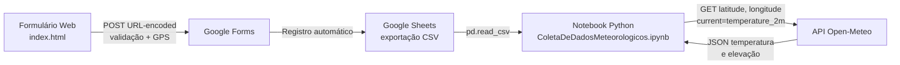

# 🌦️ Controle Meteorológico

Pipeline de ponta a ponta para cadastrar pontos geográficos em formulário web e consultar a temperatura atual de cada local via API Open-Meteo.

[](https://colab.research.google.com/github/leandromaiads/controle-meteorologico/blob/main/ColetaDeDadosMeteorologicos.ipynb)


## 🎯 O problema

Monitorar condições climáticas em múltiplos locais espalhados geograficamente costuma depender de consultas manuais isoladas ou de cadastros em planilhas com coordenadas fora de padrão (vírgulas no lugar de pontos, valores fora de faixa). Isso atrasa a conferência operacional e quebra rotinas automatizadas de coleta. Este projeto resolve a entrada padronizada das coordenadas na origem e automatiza a consulta de temperatura em lote para todos os pontos cadastrados.

## ⚙️ Como funciona



1. **Cadastro padronizado (`index.html`):** o usuário informa o nome do local e as coordenadas (manualmente ou via botão de GPS do navegador). O front-end sanitiza vírgulas para ponto, valida o formato decimal (`-90` a `90` para latitude; `-180` a `180` para longitude) e envia os dados para o Google Forms.
2. **Armazenamento em planilha:** o Google Forms grava automaticamente cada envio no Google Sheets com carimbo de data/hora, nome do local, latitude e longitude.
3. **Coleta meteorológica (`ColetaDeDadosMeteorologicos.ipynb`):** o notebook lê a planilha publicada em CSV via `pandas`, itera sobre cada linha cadastrada e consulta o endpoint `v1/forecast` da API Open-Meteo para obter a temperatura atual a 2 metros (`temperature_2m`).

## 📊 Principais achados e funcionalidades

### Funcionalidades implementadas
* **Validação na origem:** formulário responsivo em arquivo único (`index.html`) com conversão automática de vírgula para ponto, validação por regex (`/^-?\d+\.\d+$/`) e verificação de limites geográficos antes do envio.
* **Captura de GPS sob demanda:** preenchimento automático de latitude e longitude com 6 casas decimais usando a `Geolocation API` do navegador (`enableHighAccuracy: true`, timeout de 10 s).
* **Integração sem chave de API:** leitura direta do Google Sheets em CSV e consulta à API pública Open-Meteo sem necessidade de credenciais ou backend dedicado.

### Números da execução registrada no notebook
Na execução salva em `ColetaDeDadosMeteorologicos.ipynb` (snapshot da API em **19/11/2026 às 19:15 GMT**, intervalo de atualização de 15 minutos):

* **8 locais únicos** cadastrados entre `18/11/2026 14:48:50` e `19/11/2026 16:22:37` (2 registros em 18/11 e 6 em 19/11).
* **Temperatura média:** `27,6 °C` entre os 8 pontos no mesmo horário.
* **Maior temperatura:** `31,2 °C` em *Cataratas do Iguaçu (Foz do Iguaçu, PR)*.
* **Menor temperatura:** `24,0 °C` em *Cristo Redentor, (Rio de Janeiro, RJ)*.
* **Amplitude térmica simultânea:** `7,2 °C` entre o ponto mais quente e o mais ameno.
* **Faixa de elevação retornada pela API:** de `0,0 m` (*Estatua do Bom Jesus*) a `748,0 m` (*Parque Ibirapuera (São Paulo, SP)*).

| Local cadastrado | Latitude | Longitude | Temperatura (19:15 GMT) | Elevação (API) |
| :--- | :---: | :---: | :---: | :---: |
| Cataratas do Iguaçu (Foz do Iguaçu, PR) | -25.695300 | -54.436700 | 31,2 °C | 162,0 m |
| Catedral da Se | -23.550000 | -46.630000 | 29,6 °C | 737,0 m |
| Parque Ibirapuera (São Paulo, SP) | -23.588333 | -46.658890 | 29,3 °C | 748,0 m |
| PUC-Campinas – Campus I | -22.834570 | -47.047940 | 27,3 °C | 685,0 m |
| Arquipélago de Fernando de Noronha (PE) | -3.840360 | -32.411300 | 27,2 °C | 24,0 m |
| Lagoa do Taquaral (Campinas, SP) | -22.871506 | -47.050083 | 26,4 °C | 663,0 m |
| Estatua do Bom Jesus | -24.700000 | -45.550000 | 25,5 °C | 0,0 m |
| Cristo Redentor, (Rio de Janeiro, RJ) | -22.951900 | -43.210500 | 24,0 °C | 558,0 m |

## 🛠️ Tecnologias

| Camada | Ferramenta | Por que foi escolhida |
| :--- | :--- | :--- |
| Coleta (Front-end) | HTML5, CSS3 e JavaScript puro | Arquivo único estático, sem build ou dependências externas, pronto para hospedagem gratuita no GitHub Pages. |
| Ingestão e Armazenamento | Google Forms + Google Sheets | Dispensa provisionamento de servidor e banco de dados para o protótipo, com exportação nativa em CSV. |
| Processamento | Python (`pandas`, `requests`) | Leitura tabular direta da URL da planilha e consumo simples de APIs REST em poucas linhas de código. |
| Ambiente de Execução | Google Colab / Jupyter Notebook | Permite reproduzir e auditar o pipeline direto do navegador, sem configuração local. |
| Dados Meteorológicos | API Open-Meteo (`/v1/forecast`) | Gratuita para uso não comercial, sem necessidade de API key e com resposta estruturada em JSON por coordenada. |

## 💼 Perguntas de negócio (visão de gestor)

### ✅ O que a base responde
* **Quantos pontos estão monitorados atualmente?** `8` locais cadastrados na planilha, com abrangência de latitude entre `-25.6953` e `-3.84036` e longitude entre `-54.4367` e `-32.4113`.
* **Qual ponto registrou a maior e a menor temperatura no momento da coleta?** No snapshot de 19/11/2026 às 19:15 GMT, *Cataratas do Iguaçu (Foz do Iguaçu, PR)* atingiu a máxima (`31,2 °C`) e *Cristo Redentor, (Rio de Janeiro, RJ)* registrou a mínima (`24,0 °C`).
* **Existe variação térmica relevante entre pontos próximos na mesma cidade?** Sim: em Campinas (SP), a diferença entre *PUC-Campinas – Campus I* (`27,3 °C`) e *Lagoa do Taquaral* (`26,4 °C`) foi de `0,9 °C` no mesmo horário; em São Paulo (SP), entre *Catedral da Se* (`29,6 °C`) e *Parque Ibirapuera* (`29,3 °C`), foi de `0,3 °C`.

### ❌ O que a base ainda não responde
* **Como a temperatura evoluiu ao longo do dia ou da semana em cada local?** Falta persistir um histórico de coletas recorrentes (o notebook exibe apenas o estado instantâneo em tela).
* **Há risco de chuva, vento forte ou desconforto térmico nos locais monitorados?** Falta incluir variáveis meteorológicas adicionais na chamada da Open-Meteo (precipitação, umidade relativa, velocidade do vento e sensação térmica).
* **Qual é a temperatura média por estado ou região?** Falta estruturar colunas separadas de `cidade` e `uf` (atualmente essa informação está misturada em texto livre dentro de `Nome do Local` e ausente em 3 dos 8 registros).

## 🚀 Como reproduzir

### 1. Clonar o repositório
```bash
git clone [https://github.com/leandromaiads/controle-meteorologico.git](https://github.com/leandromaiads/controle-meteorologico.git)
cd controle-meteorologico
```

### 2. Usar ou publicar o formulário web
* **Teste local:** abra o arquivo `index.html` em um navegador (para testar o botão de GPS, sirva via `localhost` ou HTTPS, pois navegadores restringem a `Geolocation API` em `file://`).
  ```bash
  python -m http.server 8000
  ```
  Acesse `http://localhost:8000`.
* **Publicação no GitHub Pages:** em **Settings → Pages** no repositório do GitHub, selecione a branch `main` e a pasta `/ (root)`.
* **Apontar para o seu próprio Google Forms (opcional):** substitua `GOOGLE_FORM_ACTION` e os identificadores `FIELD_IDS` (`entry.*`) no `<script>` do `index.html`, além da constante `endpoint_planilha` no notebook.

### 3. Executar a coleta meteorológica
* **Via Google Colab (recomendado):** clique no botão **Open In Colab** no topo deste README e execute todas as células.
* **Localmente:**
  ```bash
  pip install pandas requests jupyter
  jupyter notebook ColetaDeDadosMeteorologicos.ipynb
  ```

## 📁 Estrutura do projeto

```text
controle-meteorologico/
├── ColetaDeDadosMeteorologicos.ipynb  # Lê a planilha de locais em CSV e consulta a temperatura atual na Open-Meteo
├── index.html                         # Formulário web responsivo com validação de coordenadas, GPS e envio ao Google Forms
└── README.md                          # Documentação técnica e de negócio do projeto
```

## ⚠️ Limitações conhecidas

* **Sem persistência histórica:** `ColetaDeDadosMeteorologicos.ipynb` imprime o retorno JSON de cada local na saída do notebook, mas não salva os resultados em arquivo (CSV/Parquet) nem em banco de dados.
* **Sem tratamento de erros de rede ou rate limit:** as chamadas `requests.get` não definem `timeout`, não verificam `status_code` nem utilizam pausa entre requisições (o módulo `time` está importado, mas sem uso).
* **Confirmação limitada no envio do formulário:** `index.html` envia o `POST` ao Google Forms com `mode: 'no-cors'`, o que impede o JavaScript de validar se o servidor retornou sucesso HTTP real ou erro de schema.
* **Qualidade e padronização cadastral:** o formulário não bloqueia duplicatas nem padroniza cidade/UF. Na base atual há nomes sem acento (`Estatua do Bom Jesus`, `Catedral da Se`) e uma coordenada imprecisa em `Estatua do Bom Jesus` (`-24.700000, -45.550000`), onde a API retornou `elevation: 0.0 m`.
* **Fuso horário sem normalização:** o timestamp da planilha usa o fuso do formulário, enquanto a resposta da API Open-Meteo está em `GMT` (`utc_offset_seconds: 0`).
* **Empacotamento:** o repositório ainda não contém `requirements.txt` nem `.gitignore`.

## 🔒 Privacidade e LGPD

* A base atual contém apenas referências a locais públicos/turísticos e **não coleta dados pessoais identificáveis** (nome de usuário, e-mail, CPF ou telefone).
* O botão **"Preencher com minha localização atual"** utiliza a `Geolocation API` exclusivamente sob consentimento explícito do usuário no navegador.
* Como o link CSV da planilha está acessível para leitura pelo notebook, recomenda-se **não cadastrar endereços residenciais ou localizações privadas** nesta instância pública.

## 🗺️ Próximos passos

* **Persistência e série histórica:** consolidar o retorno da Open-Meteo em um `DataFrame` estruturado com timestamp em BRT (`America/Sao_Paulo`) e gravar o histórico em CSV/SQLite (ou Google Sheets dedicado), habilitando análises temporais.
* **Enriquecimento climático:** expandir o parâmetro `current` da API para incluir precipitação, umidade relativa, sensação térmica e velocidade do vento.
* **Governança cadastral:** adicionar campos estruturados de `Cidade` e `UF` no formulário, validar coordenadas em território esperado e deduplicar registros antes da consulta.
* **Robustez e automação:** incluir `requirements.txt`, tratamento de exceções/timeout nas requisições e agendamento periódico da coleta via GitHub Actions.
* **Camada visual:** criar um dashboard a partir do histórico consolidado e versionar os prints na pasta `docs/`.

---

**Leandro Maia** · Analista de Dados Jr  
[GitHub](https://github.com/leandromaiads) · [LinkedIn](https://www.linkedin.com/in/leandro-maia-ds/)
